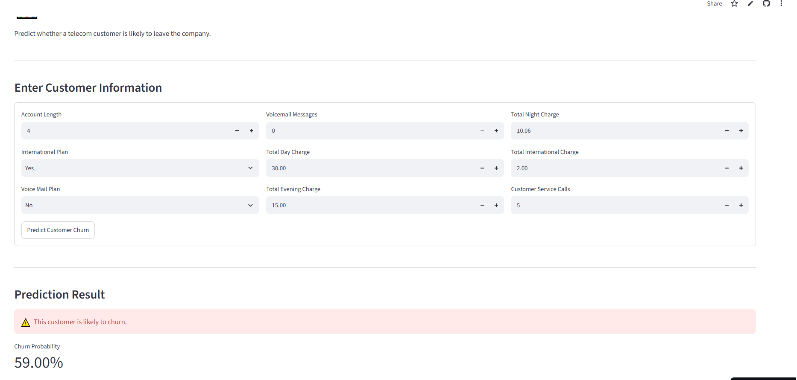

# 📊 Telecom Customer Churn Prediction

A Machine Learning application that predicts whether a telecom customer is likely to leave a company using a trained Random Forest classifier.

## 🚀 Live Application

[🚀 Launch Telecom Churn Prediction App]https://telecom-customer-churn-prediction-yyyvo55ut25bskme3btzsr.streamlit.app
## 🖥️ Application Preview


## 🎯 Project Objective

The objective is to identify customers who are likely to discontinue telecom services. This helps telecom companies understand customer behavior and develop customer-retention strategies.

## 🛠️ Technologies Used

- Python
- Pandas
- NumPy
- Scikit-learn
- Joblib
- Streamlit
- Machine Learning

## 🤖 Machine Learning Models

The following algorithms were evaluated:

- Logistic Regression
- Decision Tree
- Random Forest
- Gradient Boosting

**Selected Model:** Random Forest Classifier.

## 📈 Model Performance

| Algorithm | Accuracy | F1-score |
|---|---:|---:|
| Logistic Regression | 85.31% | 20.97% |
| Decision Tree | 90.10% | 67.33% |
| Random Forest | 94.75% | 79.04% |
| Gradient Boosting | 94.45% | 77.84% |

Random Forest achieved the highest accuracy and F1-score among the evaluated models.

## 🔍 Application Features

- Customer information input form
- Customer churn prediction
- Churn probability estimation
- Interactive Streamlit interface

## 📋 Input Features

The model uses nine customer features:

1. Account length
2. International plan
3. Voice mail plan
4. Number of voicemail messages
5. Total day charge
6. Total evening charge
7. Total night charge
8. Total international charge
9. Customer service calls

## 📂 Project Structure

```text
Telecom-Customer-Churn-Prediction/
│
├── README.md
├── app.py
├── churn_model.joblib
└── requirements.txt
```

## ⚙️ Run Locally

Install the required libraries:

```bash
pip install -r requirements.txt
```

Run the application:

```bash
streamlit run app.py
```

## 👨‍💻 Author

**Shambel Alemu**

GitHub: [shambel-data](https://github.com/shambel-data)

---

*This project demonstrates the application of machine learning to customer churn prediction and interactive web application deployment.*
